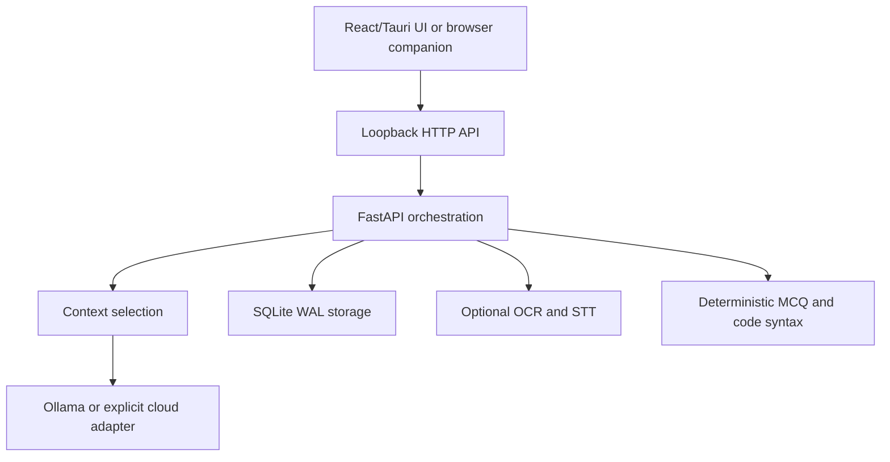

# Architecture (implemented and planned)

## Decisions

- **Tauri 2 + Rust + React + TypeScript** for a resource-conscious native shell; React frontend built with Vite, no proprietary component library.
- **Python FastAPI** on loopback for AI/ML ecosystem and separate failure isolation. A browser companion is served on the same port as a fallback.
- **SQLite** is created under the user's home directory and uses WAL, foreign keys, transactional writes and migrations via `PRAGMA user_version`.
- **Ollama** streaming on local HTTP endpoint and **OpenAI** cloud adapter (when explicitly enabled); both use async HTTP clients and a common async iterator contract.
- **Untrusted code execution disabled**. Python AST syntax checker is not a sandbox. Other languages are explicitly unverified.

## Data flow

## Interfaces

`GET /api/health`, `/api/diagnostics`, `/api/models`, `/api/stats`, `/api/sessions`, `/api/sessions/{id}/turns`, `/api/assessments`, `/api/documents`, `/api/export`; `POST /api/sessions`, `/api/ask/stream`, `/api/parse`, `/api/assessments`, `/api/assessments/{id}/submit`, `/api/code/check`, `/api/communication/feedback`, `/api/files/extract`, `/api/documents`, `/api/transcribe`; `DELETE /api/sessions/{id}`, `/api/documents/{id}`.

## State and failure handling

- Client `AbortController` allows stale streamed answers to be cancelled. A disconnected SSE request no longer updates the UI; server-side generation cancellation depends on ASGI shutdown propagation. No durable queue.
- Questions and answers are saved **only after a streamed response completes**; failed provider outputs aren't incorrectly persisted.
- Recent 6 turns are selected (bounded by per-turn length). Resume/project snippets selected by lexical retrieval and bounded to ~3.5k characters. This is a baseline, not embedding-based RAG.
- Loading audio models is lazy. Output latency is never guaranteed.
- Native packaged worker is intended to be started by Rust from a bundled executable. If developer already started one on port 8765, Rust does not start another. Windows has not yet verified this.

## Planned hardening

Authenticated worker IPC, Windows key vault, signed installer, resource governor, true streaming STT, continuous dual audio, mature model feature negotiation, offline embedding retrieval, sandboxed verification, multi-monitor/capture compatibility testing.
